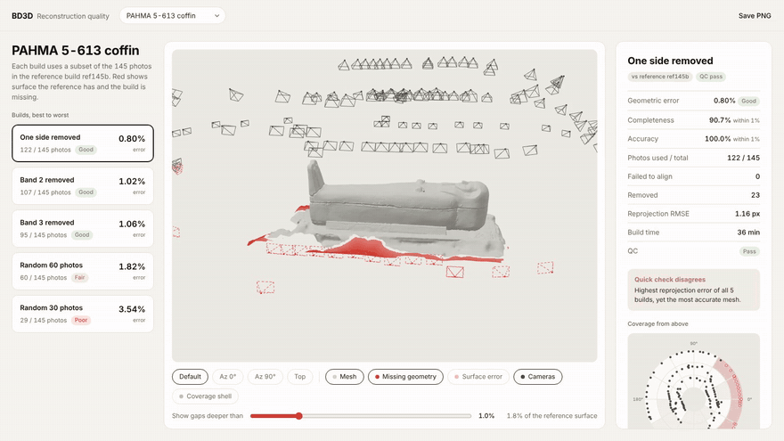
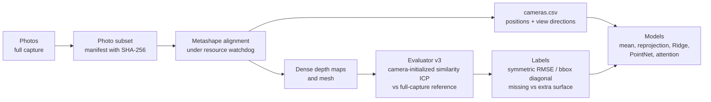
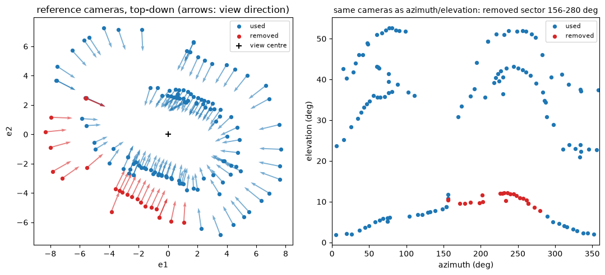
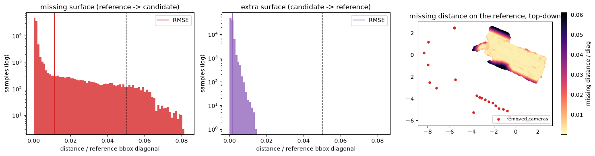
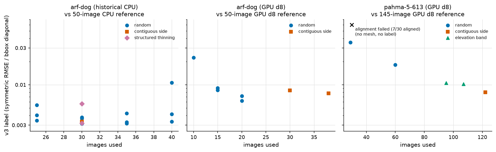

# Predicting photogrammetric reconstruction quality from camera layout

This repository measures how much a photogrammetric mesh degrades when photos are removed from a
capture, and tests whether that loss can be predicted from the aligned cameras alone, before the
slow dense reconstruction.



Full video: [VIDEO_URL](VIDEO_URL)

## The problem

Dense reconstruction is the slow step: the 145-photo reference build of the PAHMA 5-613 coffin
took 3448 s on a 16 GB laptop at reduced depth-map resolution
(`results/overnight-2026-11-10/chain-status.json`, `ref145b_status`). The usual quick check after
alignment is the reprojection RMSE from bundle adjustment. It measures how consistent the kept
observations are, not whether the object is covered. In the coffin builds, the worst mesh had
the lowest reprojection RMSE and the best mesh had the highest:

| coffin build | photos | reprojection RMSE (px) | label |
|---|---|---|---|
| `random30_s20261111` (worst) | 29 aligned | 0.67 | 0.0354 |
| `side40_s1` (best) | 122 | 1.16 | 0.0080 |

Source: `results/pahma-5-613-v2/labels-all.csv`. The label is the surface RMSE against the
reference build, as a fraction of its bounding-box diagonal ([docs/METHOD.md](docs/METHOD.md)).

## What's here

### Pipeline



Each build starts from a manifest that lists every photo by SHA-256 together with the
reconstruction settings, so a build can be traced back to its exact inputs. Metashape runs under
a watchdog that stops it before it exhausts memory on a 16 GB machine. Evaluator v3 registers
each candidate mesh to the reference by first fitting the candidate's cameras to the reference
cameras, because builds without markers are in arbitrary frames. Stages, commands and the files
each stage writes are in [docs/PIPELINE.md](docs/PIPELINE.md).

### Capture app

`coverage_app.py` is a desktop app for one capture. It takes a photo folder through alignment,
a camera-coverage check against an earlier build of the same object, an optional mesh, and a v3
score. It also opens any existing build. Alignment and meshing call the same watched commands as
the pipeline.

### 3D viewer

`viewer/` is a browser view of a build: its mesh, its cameras and its coverage gaps. With a
reference, it also shows the surface the reference has and the build is missing, after the same
registration as the labels. The pipeline and the app write its data after each build
([viewer/README.md](viewer/README.md)).

## How one build is scored

[`notebooks/01_pipeline_walkthrough.ipynb`](notebooks/01_pipeline_walkthrough.ipynb) follows one
coffin build, `side40_s1`, from its manifest to its label. It recomputes each value step by step and
compares it with the stored row in `results/pahma-5-613-v2/labels-all.csv`; all 14 columns match
exactly. The figures below are its outputs (`scripts/export_notebook_figures.py`).

**Cameras.** The build keeps 122 of the 145 photos: 23 consecutive wall-level photos are removed,
a sector from 156° to 280° in azimuth.



**Registration.** A build without markers comes out of Metashape in its own frame (left). Fitting
the build's cameras to the reference cameras of the same photos does most of the alignment
(middle), and ICP on the two surfaces makes a small final correction (right). v1 started ICP
without the camera fit, which is the failure described in the evaluation audit below.


**Distances.** Every reference sample is matched to the nearest point on the build (missing
surface), and every build sample to the reference (extra surface). The missing distances are
largest on the side where the cameras were removed (right panel). Missing RMSE is 0.0112 of the
reference diagonal and extra RMSE is 0.0015, so the label, the root mean square of the two, is
0.0080, and 98% of the squared error is missing surface.



## Findings

The long versions, with every table and figure, are in [docs/FINDINGS.md](docs/FINDINGS.md).

### Evaluation audit


The first evaluator (v1) started ICP with no rotation. Among 16 historical dog builds, 7 were in
frames rotated 135.7–166.9° from the reference, and v1 gave all 7 labels of 0.0421–0.0444 from
misregistration. With v3 the same 7 builds score 0.0033–0.0055 (`docs/figures/data/stats.json`).
Three of my earlier results, on the Aphoma `bd3d-ml` branch, used v1 labels and do not hold
with v3; I retract them. For example, the 5.7× error ratio between two 30-photo conditions
becomes 0.58× (`results/bd3d-ml-claims-recheck/claims.csv`).

### Synthetic benchmark

| model | global gap, MAE (°) | localized gap, MAE (°) |
|---|---|---|
| mean | 34.89 ± 0.77 | 33.47 ± 0.86 |
| Ridge on summaries | 12.26 ± 0.15 | 27.70 ± 0.51 |
| PointNet | 12.99 ± 0.84 | 28.82 ± 0.63 |
| attention | 7.14 ± 0.39 | 13.99 ± 1.06 |

Source: `results/synthetic-coverage-gap/summary.csv`, mean ± std over 5 seeds. The target is the
largest azimuthal gap in a synthetic camera set. In the localized condition one ring of cameras
is complete and the gap is in the other ring, so a model has to work out which cameras are
missing. There, only the attention model, which compares cameras with each other before
pooling, cuts the mean baseline's error by more than half.

### Real-data observations



Within each object, reprojection RMSE moved opposite to the label: Spearman ρ −0.68 for the dog
(n = 7) and −0.90 for the coffin (n = 5) (`docs/figures/data/stats.json`). Removing 23
wall-level photos from one sector (`side40_s1`) gave the lowest coffin label, 0.0080; removing
38 and 50 photos as elevation bands gave 0.0102 and 0.0106 (`results/pahma-5-613-v2/labels-all.csv`).
No random subset removed a comparable number of photos, so side and random removal are not
compared at equal counts. One 30-photo random coffin subset aligned only 7
cameras and produced no mesh (`docs/figures/data/real_runs.csv`).

### Pilot

| model | leave one build out, MAE | leave one object out, MAE |
|---|---|---|
| mean | 0.0046 | 0.0108 |
| reprojection RMSE | 0.0042 | 0.0395 |
| Ridge on summaries | 0.0030 | 0.0237 |
| PointNet | 0.0037 | 0.0041 |
| attention | 0.0034 | 0.0035 |

Source: `results/pilot-real-v3-all/summary.csv`; the networks are means over 5 seeds. On 28 real
builds of two objects, Ridge and the reprojection fit fail when the object is held out, because
their inputs shift between objects. PointNet and attention hold a leave-one-object-out MAE of
0.0041 and 0.0035, close to their leave-one-build-out MAE of 0.0037 and 0.0034. With
two folds, this is a feasibility check, not evidence that any model predicts quality.

## Limitations

- Two objects and 28 labelled builds. Builds from one capture share photos and are correlated.
- Labels are relative to a reference build of the same object, not to a ground-truth scan.
- All new builds use reduced depth-map resolution (Metashape downscale 8) to fit a 16 GB laptop.
- Most candidates remove photos by design, so the label range reflects the experiments, not
  natural captures.
- The synthetic target is an angular gap, not surface error.

## Quickstart

Install (Python 3.11+; `requirements-lock.txt` pins the versions that produced the results):

```bash
python3 -m venv .venv
source .venv/bin/activate
python -m pip install -e '.[test,ml,local]' -c requirements-lock.txt
python -m pytest -q
```

Open the capture app. Opening existing builds works without Metashape; aligning and meshing need
it ([docs/METASHAPE.md](docs/METASHAPE.md)):

```bash
python coverage_app.py
```

Open the viewer. Exports are made from local meshes, so first export a build you have:

```bash
python -m bd3d_quality.viewer_export build <build folder> [--reference <reference folder>]
python -m bd3d_quality.viewer_export serve
```

Reproduce the figures and the results notebook from the tracked CSVs:

```bash
python scripts/make_figures.py
python scripts/build_results_notebook.py
```

The other scripts, in run order, are listed in [scripts/README.md](scripts/README.md).

## Repository layout

```
coverage_app.py      capture app
src/bd3d_quality/    package: manifests, Metashape runner, watchdog, evaluator v3, coverage, viewer export
scripts/             reproduce steps, in run order (scripts/README.md)
tests/               unit and regression tests; Metashape is mocked
docs/                METHOD, PIPELINE, FINDINGS, METASHAPE, attribution, figures
notebooks/           01 pipeline walkthrough, 02 results, 03 attention maps
viewer/              3D viewer page and design tokens
config/              reconstruction settings
experiments/         manifests for every build
results/             labels, summaries and per-build camera tables (results/README.md)
archive/             earlier-phase code, superseded scripts and documents (archive/README.md)
```

## Attribution

Parts of the mesh loading, sampling and ICP code, and the manifest and metrics concepts, are
adapted from the Aphoma repository (`bd3d-ml` branch), released under CC0 1.0
([docs/ATTRIBUTION.md](docs/ATTRIBUTION.md), [docs/APHOMA_CC0.txt](docs/APHOMA_CC0.txt)). Photos,
Metashape projects and meshes of the two objects are not distributed here.
