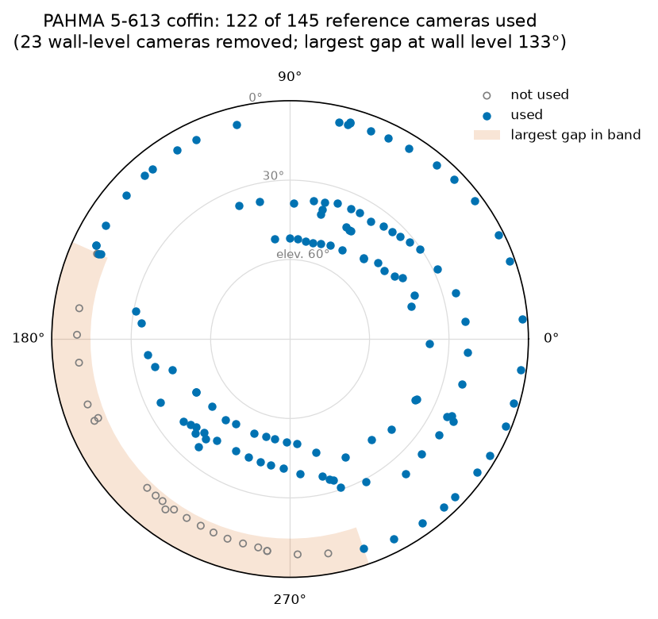
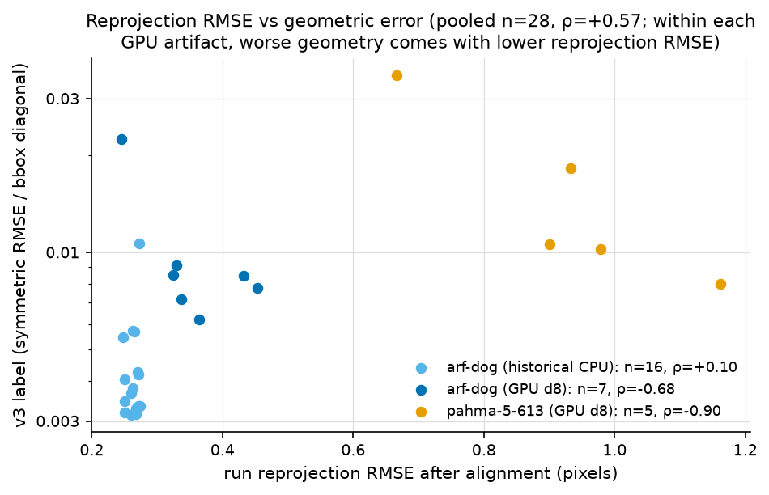
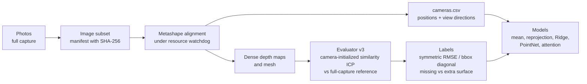
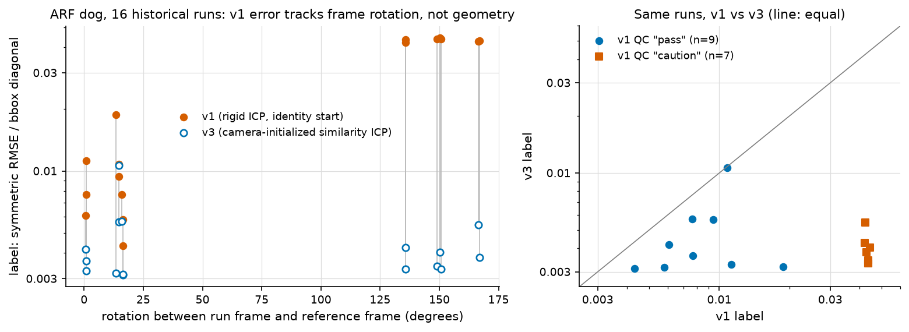
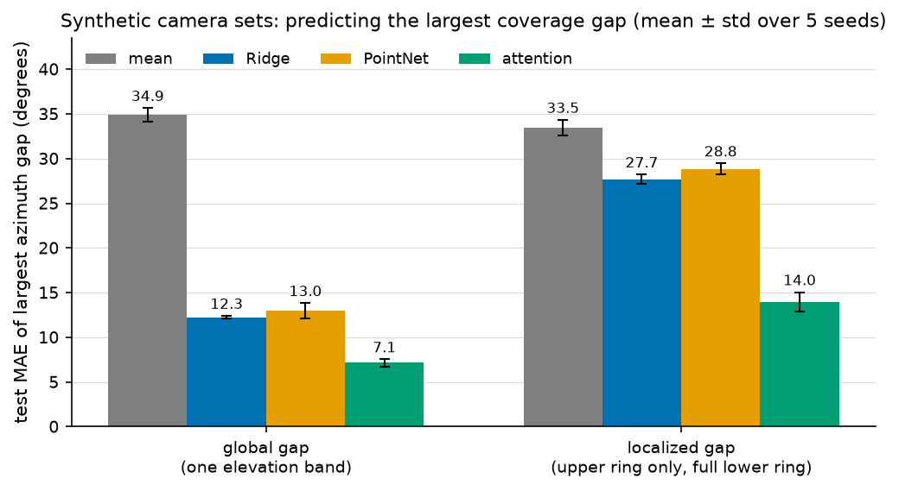
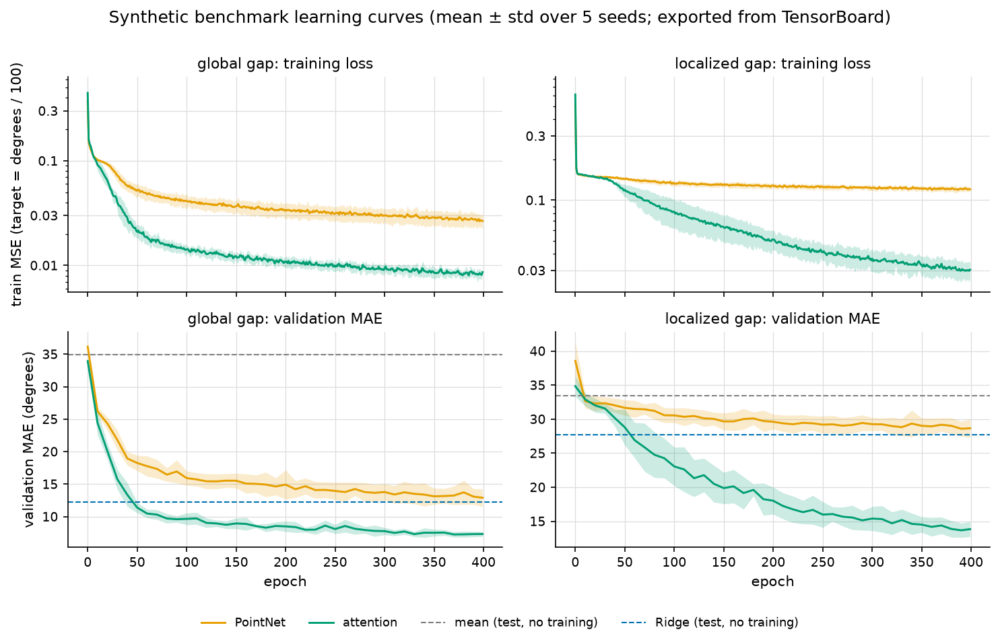
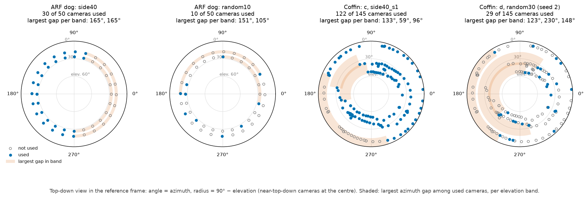
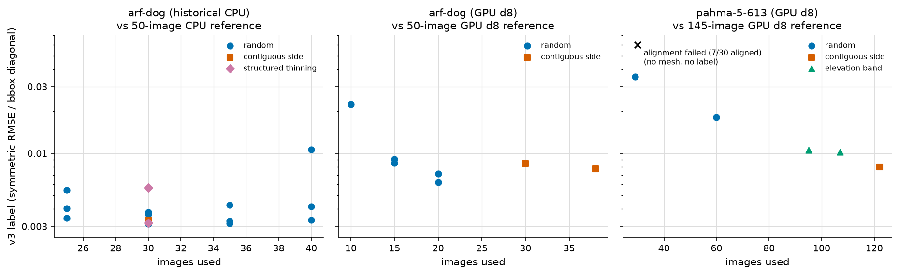
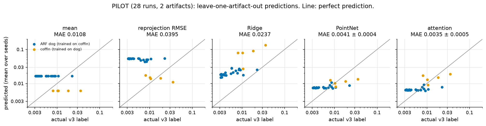
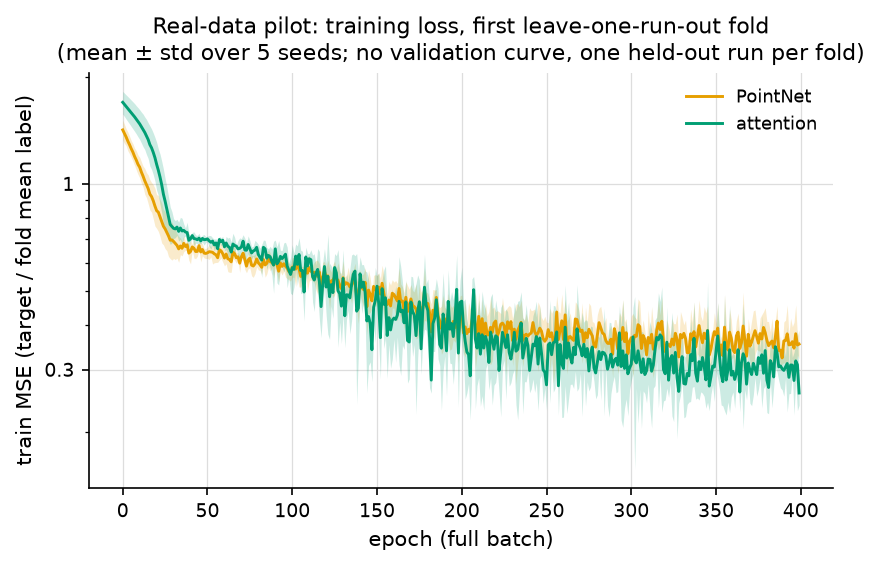

# Predicting photogrammetric reconstruction quality from camera layout



## Key results

- **Evaluation audit:** 7 of 16 v1 labels were registration failures (frames rotated 135.7–166.9°; v1 0.042–0.044 vs v3 0.0033–0.0055). Three earlier claims are retracted: 5.7×, ρ −0.17 and 13.7% (`docs/figures/data/stats.json`, `results/bd3d-ml-claims-recheck/claims.csv`).
- **Synthetic, localized gaps:** attention MAE 13.99 ± 1.06° vs Ridge 27.70 ± 0.51° and mean 33.47 ± 0.86°, over 5 seeds (`results/synthetic-coverage-gap/summary.csv`).
- **Real data:** within each object, reprojection RMSE moved opposite to geometric error: ρ −0.68 for the dog (n=7), −0.90 for the coffin (n=5). The samples are small (`docs/figures/data/stats.json`).
- **Pilot only (28 runs, 2 objects):** with one object held out, the set models (MAE 0.0035–0.0041) beat the mean (0.0108), while Ridge on summaries (0.0237) and reprojection RMSE (0.0395) fail (`results/pilot-real-v3-all/summary.csv`).

This project asks whether the quality of a photogrammetric reconstruction can be predicted
from the aligned camera layout alone, before the slow dense-reconstruction step. Each
experiment removes images from a full capture of an archaeological object (at random, as a
contiguous side, or as an elevation band) and reconstructs the rest in Agisoft Metashape. It
then measures how far the resulting mesh is from a reconstruction made with all images. That
distance is the label. The input to a model is the set of aligned cameras: where each camera
is and which way it points. The repository holds the experiment pipeline with provenance
tracking and a resource watchdog, a corrected geometric evaluator, a synthetic benchmark of
set models, and a small real-data pilot on two objects. The real-data results are a pilot and
should be read that way.

## Motivation

Dense reconstruction is the expensive step. The 145-image coffin reference took 3448 s
(57.5 min) on a 16 GB laptop, even at reduced depth-map resolution (Metashape downscale 8)
on the GPU (`results/overnight-2026-11-10/chain-status.json`, `ref145b_status`). Knowing
after alignment that a capture will produce a poor mesh would save that time, and would tell
the photographer where coverage is missing while the object is still available.

The usual quick quality number, the reprojection RMSE from bundle adjustment, measures how
consistent the retained observations are. It does not measure whether the whole object is
covered. In the coffin runs the worst mesh had the *lowest* reprojection RMSE, and the best
mesh had the highest:

| coffin run | images | reprojection RMSE (px) | v3 label |
|---|---|---|---|
| `random30_s20261111` (worst) | 29 aligned | 0.67 | 0.0354 |
| `side40_s1` (best) | 122 | 1.16 | 0.0080 |

Source: `results/pahma-5-613-v2/labels-all.csv`.



Spearman ρ between reprojection RMSE and the v3 label (source: `docs/figures/data/stats.json`):

| runs | n | ρ |
|---|---|---|
| ARF dog, historical CPU runs | 16 | +0.10 |
| ARF dog, GPU runs | 7 | −0.68 |
| PAHMA 5-613 coffin, GPU runs | 5 | −0.90 |
| all pooled | 28 | +0.57 |

Within each GPU artifact, removing images lowered the reprojection RMSE while the geometry got
worse. The pooled positive value reflects the difference between the two objects, not
within-object quality.

## Pipeline



- **Label.** Symmetric RMSE between candidate and reference meshes after registration,
  divided by the reference bounding-box diagonal. A label of 0.01 means an RMSE of 1% of
  the object's diagonal.
- **Breakdown.** *Missing surface* is reference surface the candidate does not reconstruct
  (reference → candidate distances). *Extra surface* is candidate surface with no counterpart
  in the reference (candidate → reference).
- **Reference.** Each label is relative to a reconstruction from the full capture at the same
  settings, not to ground truth.
- **Traceability.** Every run records its manifest identity, settings, software versions,
  stage timings and resource use. CLI and safeguard details are in
  [docs/PIPELINE_REFERENCE.md](docs/PIPELINE_REFERENCE.md).

## Pipeline at a glance

The commands behind the coffin results, from photos to figures. The dog runs use the same
steps with the manifests in `experiments/gpu-pilot-d8*/`. Steps 1–4 need Metashape and the
photos; step 5 needs the local run folders; steps 6–7 run from files in git.
`<photos>` is the folder of the full capture.

1. **Manifest of the full capture.** In: photos. Out: a manifest listing every image with its
   SHA-256, the reconstruction settings and an experiment ID.
   ```bash
   bd3d-quality manifest create --root <photos> --dataset-id pahma-5-613-processed-145 \
       --config experiments/pahma-5-613/config.json --output experiments/pahma-5-613/parent-145.json
   ```
2. **Reference reconstruction**, under the resource watchdog. `ref145b.json` is a copy of
   `parent-145.json`; the driver names each run folder after its manifest file, and the earlier
   `ref145` attempts were stopped by license denials. In: manifest and photos. Out:
   `results/pahma-5-613-v2/ref145b/` with `cameras.csv` (aligned camera positions and view
   directions), `raw-mesh.obj`, `run.json` and stage metrics, plus watchdog records.
   ```bash
   python scripts/run_watched.py --manifests experiments/pahma-5-613/ref145b.json --root <photos> \
       --output-dir results/pahma-5-613-v2 --seconds 7200 --swap-growth-mib 6144 --rss-gib 6
   ```
3. **Image-quality cache and capture series.** In: the reference run. Out:
   `image_quality_cache.csv` (reused by the subsets) and `series_split/series.csv`; then the
   candidate manifests in `experiments/pahma-5-613/candidates/` (series removals, a contiguous
   side, random subsets).
   ```bash
   python scripts/build_image_quality_cache.py results/pahma-5-613-v2/ref145b \
       --output results/pahma-5-613-v2/image_quality_cache.csv
   python scripts/series_split_from_poses.py --cameras results/pahma-5-613-v2/ref145b/cameras.csv \
       --images <photos> --k 3 --output results/pahma-5-613-v2/series_split
   python scripts/make_pahma_manifests.py --parent experiments/pahma-5-613/parent-145.json --root <photos> \
       --series results/pahma-5-613-v2/series_split/series.csv --seeds 20261110 20261111 \
       --output experiments/pahma-5-613/candidates
   ```
4. **Candidate reconstructions.** In: candidate manifests, photos, cache. Out: one run folder
   per candidate in `results/pahma-5-613-v2/`; an alignment failure is recorded in
   `<run>-pilot-status.json` and the driver moves on.
   ```bash
   python scripts/run_watched.py --manifests experiments/pahma-5-613/candidates/*.json --root <photos> \
       --output-dir results/pahma-5-613-v2 --image-quality-cache results/pahma-5-613-v2/image_quality_cache.csv
   ```
5. **Labels (evaluator v3).** In: the run folders (`raw-mesh.obj`, `cameras.csv`, `run.json`).
   Out: `geometry-v3-all/labels_v3.csv` (one row per run: label, QC, scale check, distances)
   and `labels-all.csv` (adds the missing/extra-surface breakdown and run context). The
   historical dog labels come from `rescore_camera_init_icp.py` (see its docstring).
   ```bash
   python scripts/score_runs_v3.py --reference results/pahma-5-613-v2/ref145b \
       --candidates results/pahma-5-613-v2/{drop_s3,drop_s2,random30_s20261111,side40_s1,random60_s20261112} \
       --output results/pahma-5-613-v2/geometry-v3-all
   python scripts/combine_labels.py --artifact pahma-5-613 --scores results/pahma-5-613-v2/geometry-v3-all \
       --runs-dir results/pahma-5-613-v2 --output results/pahma-5-613-v2/labels-all.csv
   ```
6. **Models.** In: label CSVs and each run's `cameras.csv` (all in git); the synthetic
   benchmark needs no input. Out: `results/synthetic-coverage-gap/` (and TensorBoard logs in
   `runs/synthetic/`) and `results/pilot-real-v3-all/` (`summary.csv`, `predictions.csv`,
   `runs.csv`, learning curves).
   ```bash
   python scripts/synthetic_coverage_gap.py
   python scripts/pilot_set_models.py --output results/pilot-real-v3-all \
       --coffin-labels results/pahma-5-613-v2/labels-all.csv
   ```
7. **Figures and notebook.** In: `results/` files in git. Out: `docs/figures/*.png`,
   `docs/figures/data/stats.json` (every derived number cited here) and `notebooks/results.ipynb`.
   ```bash
   python scripts/make_figures.py
   python scripts/build_results_notebook.py --pilot results/pilot-real-v3-all \
       --coffin-labels results/pahma-5-613-v2/labels-all.csv
   ```

**Key files.**

- `src/bd3d_quality/evaluation.py`: the scorer (evaluator v3): camera-initialized similarity ICP, then surface distances and the label.
- `<run>/cameras.csv` and `<run>/raw-mesh.obj`: each run's aligned cameras (model input) and mesh (scored against the reference; local only).
- `src/bd3d_quality/manifests.py` + `provenance.py`: image manifests with SHA-256 and experiment IDs, and run provenance records.
- `scripts/synthetic_coverage_gap.py` and `scripts/pilot_set_models.py`: the synthetic benchmark and the real-data pilot models.
- `scripts/make_figures.py`: every README figure and `docs/figures/data/stats.json`.

## Findings

### a. Evaluation audit: the first labels measured registration failure, not geometry



The first evaluator (v1) registered each candidate mesh to the reference with rigid ICP,
starting from a centroid shift and no rotation. Metashape reconstructions without markers are
in arbitrary local frames, and v1 did not account for that.

- **Frame rotation.** Among the 16 historical ARF dog runs, 7 were in frames rotated
  135.7–166.9° from the reference. The other 9 were within 0.6–16.5°.
- **What v1 measured.** ICP cannot recover a rotation that large from an identity start. All
  7 large-rotation runs were flagged "caution" by v1 and received labels of 0.0421–0.0444,
  a plateau set by misregistration. All 9 small-rotation runs were "pass".
- **The fix (v3).** The initial transform is a similarity fit (rotation, translation,
  uniform scale) of each run's camera centres onto the reference cameras over shared images.
  ICP then refines it with uniform scale allowed. Runs where ICP scale and camera scale
  disagree by more than 2.5% are flagged.
- **Result.** All 16 runs pass QC with scale agreeing. Labels span 0.0031–0.0107, and the 7
  formerly failed runs fall at 0.0033–0.0055.

Sources: `docs/figures/data/evaluation_audit.csv` and `docs/figures/data/stats.json` (both
derived from `results/geometry-labels-v3/reports/*.json`), and
`results/geometry-labels-v3/labels_v3.csv`. Full write-up:
`results/geometry-labels-v3/NOTES.md`.

**Consequence for earlier results.** Three figures reported on the Aphoma `bd3d-ml` branch
(`docs/RESULTS.md`) used v1 labels. Recomputed from the same modeling table with v3 labels,
none of them holds:

| claim (bd3d-ml, v1 labels) | reproduced with v1 | with v3 labels |
|---|---|---|
| central gap vs remove-strongest-overlap, 30 images: 5.7× higher error | 5.68× | 0.58× (central gap is lower) |
| Spearman ρ, reprojection RMSE vs geometric error: −0.17 | −0.174 | +0.103 |
| early-SfM Ridge, leave-one-condition-out RMSE improvement over reprojection baseline: 13.7% | 13.7% | −5.6% (worse) |
| same model, improvement over image-count baseline: 11.2% | 11.2% | −0.5% |
| same model, improvement over dummy: 10.7% | 10.7% | −12.0% |

Source: `results/bd3d-ml-claims-recheck/claims.csv` (`scripts/recheck_bd3d_ml_claims.py`).

### b. Synthetic benchmark: attention reads localized gaps, global summaries do not



**Data.**
- Synthetic camera sets of up to 60 cameras (`nmax` in the config file), each placed in a
  random similarity frame and then normalized by centroid and median camera distance.
- The target is the largest azimuthal coverage gap, in degrees.
- *Global*: one elevation band, with the gap cut from all cameras.
- *Localized*: a full lower ring plus an upper ring that contains the gap, so a model has to
  find which cameras are missing.
- 3000 training, 600 validation and 600 test sets per seed, 400 epochs, 5 seeds
  (`results/synthetic-coverage-gap/config.json`).

**Models.**
- Ridge on rotation-invariant summaries: count, covariance eigenvalues, radial mean and std.
- PointNet: a per-camera MLP followed by max-pooling.
- Attention: one self-attention layer before the pooling.
- The networks see a fresh random rotation of each set at every step.

| model | global gap, MAE (°) | localized gap, MAE (°) |
|---|---|---|
| mean | 34.89 ± 0.77 | 33.47 ± 0.86 |
| Ridge | 12.26 ± 0.15 | 27.70 ± 0.51 |
| PointNet | 12.99 ± 0.84 | 28.82 ± 0.63 |
| attention | **7.14 ± 0.39** | **13.99 ± 1.06** |

Mean ± std over 5 seeds. Source: `results/synthetic-coverage-gap/summary.csv`.

- **Global gap.** All three models beat the mean.
- **Localized gap.** The global summaries and PointNet barely improve on the mean (skill
  0.17 and 0.14). Attention, which lets cameras compare with each other before pooling,
  keeps most of its skill (0.58). Skill values are from the same file.



### c. Real data: how removal pattern shows up in the labels

Two objects, each reconstructed at reduced depth-map resolution (Metashape downscale 8) on
the GPU:
- **ARF dog:** 50 photos in two 25-image rings.
- **PAHMA 5-613 coffin:** 145 photos in three capture series: a circuit facing the walls, a
  circuit at about 45°, and near top-down.

Every candidate is scored against the full-capture reconstruction of its own object.



**ARF dog, against the 50-image reference.** Source: `results/gpu-pilot-d8-ext/labels.csv`.

| run | images | v3 label | missing RMSE | extra RMSE | dominant (share of squared error) | reproj. RMSE (px) |
|---|---|---|---|---|---|---|
| random10 | 10 | 0.0225 | 0.0304 | 0.0094 | missing (91%) | 0.25 |
| random15, seed 20261111 | 15 | 0.0091 | 0.0119 | 0.0050 | missing (85%) | 0.33 |
| random15, seed 20261110 | 15 | 0.0085 | 0.0105 | 0.0059 | missing (76%) | 0.32 |
| side40 (20 removed, one sector) | 30 | 0.0085 | 0.0101 | 0.0065 | missing (71%) | 0.43 |
| side25 (12 removed, one sector) | 38 | 0.0078 | 0.0073 | 0.0083 | extra (56%) | 0.45 |
| random20, seed 20261110 | 20 | 0.0072 | 0.0091 | 0.0044 | missing (82%) | 0.34 |
| random20, seed 20261111 | 20 | 0.0062 | 0.0073 | 0.0050 | missing (68%) | 0.36 |

**PAHMA 5-613 coffin, against the 145-image reference.** Source:
`results/pahma-5-613-v2/labels-all.csv`. The failed run is from `docs/figures/data/real_runs.csv`.

| run | images | v3 label | missing RMSE | extra RMSE | dominant (share of squared error) | reproj. RMSE (px) |
|---|---|---|---|---|---|---|
| random30, seed 20261111 | 29 aligned | 0.0354 | 0.0499 | 0.0039 | missing (99%) | 0.67 |
| random60 | 60 | 0.0182 | 0.0257 | 0.0022 | missing (99%) | 0.93 |
| drop_s3 (highest elevation cluster) | 95 | 0.0106 | 0.0139 | 0.0055 | missing (86%) | 0.90 |
| drop_s2 (middle elevation cluster) | 107 | 0.0102 | 0.0080 | 0.0120 | extra (69%) | 0.98 |
| side40_s1 (23 wall-level cameras, one sector) | 122 | 0.0080 | 0.0112 | 0.0015 | missing (98%) | 1.16 |
| random30, seed 20261110 | 30 | — | — | — | alignment failed (7 of 30 cameras aligned) | 0.33 |

All scored runs pass registration QC, and camera and ICP scale agree.



**What the tables show.**
- **Random removal mostly loses surface.** In every random subset, missing surface is the
  larger error component (68–99% of the squared error). It reaches 99% for the coffin at 60
  and 30 images.
- **A contiguous side costs less than the same number of images removed at random.**
  - Dog: removing 20 images as one sector (side40, 30 used) scored 0.0085. That is about the
    same as keeping only 15 random images (0.0085 and 0.0091).
  - Coffin: removing 23 wall-level images as one sector scored 0.0080. Keeping 60 random
    images scored 0.0182.
  - These are designed comparisons on two objects, not a general rule.
- **Extra surface dominates in two runs:** coffin drop_s2 and dog side25. Their candidate
  meshes contain geometry the reference does not, which is consistent with noisier surfaces
  where coverage is thinner.
- **Too few images can stop the pipeline before any mesh exists.** One 30-image random coffin
  subset aligned only 7 cameras. A useful model needs to predict that outcome as well as the
  label.

**Note on the coffin series runs.** The 45° and near-top-down series overlap in elevation
(21–43° and 31–53° in the reference frame), so the pose-based clusters mix them. drop_s3
removed the 50 highest cameras: 31 near-top-down and 19 from the 45° circuit. The wall-level
circuit matches its capture series exactly. Source: `results/overnight-2026-11-10-summary.md`.

### d. PILOT: model comparison on 28 real runs from 2 artifacts

This is a feasibility check with very small, correlated data. It is not evidence that any
model predicts reconstruction quality.

**Data.** 28 runs: 16 historical CPU runs and 7 GPU runs of the ARF dog, plus 5 GPU runs of
the coffin (`results/pilot-real-v3-all/runs.csv`).

**Inputs and models.**
- Inputs are the aligned cameras: positions centred on their centroid and divided by the
  median camera distance, plus viewing directions. Training uses random-rotation
  augmentation.
- Models: the training mean, a linear fit on run reprojection RMSE, Ridge on global
  summaries, and PointNet and attention set models (hidden size 32).

**Evaluation.** Leave one run out (LORO) and leave one artifact out (LOAO), with 5 seeds for
the networks. The other three models are deterministic, so their std is 0.

| model | LORO MAE | LORO skill | LOAO MAE | LOAO skill |
|---|---|---|---|---|
| mean | 0.00461 | 0 | 0.01082 | 0 |
| reprojection RMSE | 0.00422 | +0.08 | 0.03945 | −2.65 |
| Ridge | **0.00303** | **+0.34** | 0.02365 | −1.19 |
| PointNet | 0.00365 ± 0.00003 | +0.21 ± 0.01 | 0.00409 ± 0.00044 | +0.62 ± 0.04 |
| attention | 0.00343 ± 0.00013 | +0.26 ± 0.03 | **0.00351 ± 0.00053** | **+0.68 ± 0.05** |

Source: `results/pilot-real-v3-all/summary.csv`. Skill = 1 − MAE / MAE of the mean baseline.



**Reading the table.**
- **Leave one run out:** Ridge on global summaries does best. Subsets of the same capture
  share images, so this scheme is optimistic.
- **Leave one artifact out:** Ridge and the reprojection fit fail, because their inputs shift
  between objects. Coffin runs have reprojection RMSE around 0.7–1.2 px, dog runs 0.25–0.45 px.
  The set models stay in a plausible range but underpredict the worst coffin run (figure
  above).
- **The mean baseline is weak here** because it predicts the other object's mean, so the
  positive LOAO skill values are inflated.
- With two folds and 28 correlated runs, none of these differences is reliable.



## Limitations

- **Tiny n.** There are 28 labelled real runs from 2 objects. Runs that share a capture are
  correlated, and there are only two independent objects to hold out.
- **Labels are reference-relative.** Each object is scored against its own full-capture
  reconstruction, which has its own errors. The historical dog runs (CPU) and the GPU runs
  use different references, so their labels are only roughly comparable.
- **Reduced resolution.** All new runs use Metashape downscale 8 for depth maps, chosen to
  fit a 16 GB laptop. Labels at full resolution may differ.
- **Designed failures.** Most candidates remove images on purpose, so the label range
  reflects the experimental design, not natural captures.
- **The synthetic target is a proxy.** The synthetic benchmark predicts an angular gap, not
  surface error. It shows the models can read camera layout, not that layout determines
  reconstruction quality.
- **The coffin elevation bands mix capture series** (see section c).

## Next steps

- A third artifact, so that leave-one-artifact-out has more than two folds.
- Rerun the two coffin band removals on the true capture series. The capture-time split is
  now fixed: it ignores a pause after the first or last photo.
- Repeat a subset of runs at full depth-map resolution to measure how much downscale 8
  changes the labels.
- Predict alignment failure as a separate outcome.

## Reproduce

### Setup

```bash
python3 -m venv .venv
source .venv/bin/activate
python -m pip install -e '.[test,ml,local]' -c requirements-lock.txt
python -m pytest -q                  # core tests
python -m pytest -q archive/tests    # tests of the archived earlier-phase code
```

`requirements-lock.txt` pins the exact versions that produced the results and figures. The
same environment runs the tests, the models and the figures.

Metashape is only needed to produce new reconstructions. It is licensed separately. Point
`BD3D_METASHAPE_PYTHON` at an interpreter that can `import Metashape` (see `.env.example`
and [docs/METASHAPE.md](docs/METASHAPE.md)). Photos, Metashape projects and meshes are not in
this repository.

### Figures and tables

| output | command | inputs |
|---|---|---|
| all figures in `docs/figures/`, plus `docs/figures/data/stats.json` | `python scripts/make_figures.py` | `results/` CSVs in git. Camera layouts and learning curves use local run folders and `runs/synthetic` when present, otherwise the cached tables in `docs/figures/data/` |
| synthetic benchmark table, TensorBoard logs | `python scripts/synthetic_coverage_gap.py` | none (about 12 min on 4 CPU threads) |
| pilot table | `python scripts/pilot_set_models.py --output results/pilot-real-v3-all --coffin-labels results/pahma-5-613-v2/labels-all.csv` | label files and the `cameras.csv` of each run, all in git |
| evaluation audit labels | `python scripts/rescore_camera_init_icp.py --historical <dir> ...` (see its docstring) | the historical label CSV, reports and meshes (local), camera tables in git |
| real-data label tables | `python scripts/score_runs_v3.py ...` then `python scripts/combine_labels.py ...` (see Pipeline at a glance) | local run folders (`raw-mesh.obj`, `cameras.csv`, `run.json`); no other repository |
| bd3d-ml recheck | `python scripts/recheck_bd3d_ml_claims.py --dataset <bd3d>/analysis_outputs/fast_dense_geometry_dataset_v1/fast_dense_geometry_modeling_dataset_v1.csv --output results/bd3d-ml-claims-recheck` | the Aphoma modeling table (local) |
| results notebook | `python scripts/build_results_notebook.py` | as for the figures |

Script-by-script descriptions: [scripts/README.md](scripts/README.md).

### TensorBoard

Training logs for the synthetic benchmark are written to `runs/synthetic/<condition>/<model>/<seed>`.
`runs/` is not in git. To browse them after running the benchmark:

```bash
tensorboard --logdir runs/synthetic
```

The same curves are exported to `docs/figures/learning_curves_synthetic.png` by
`scripts/make_figures.py`. That script also caches them in
`docs/figures/data/learning_curves_synthetic.csv`, so the figure regenerates without the logs.

## Results notebook

[notebooks/results.ipynb](notebooks/results.ipynb) is the visual companion to this page. It
loads only saved CSVs and logs: example camera layouts, the synthetic benchmark, learning
curves, the label tables and the pilot comparison. Rebuild it with
`python scripts/build_results_notebook.py`.

[notebooks/pipeline_walkthrough.ipynb](notebooks/pipeline_walkthrough.ipynb) follows one coffin run
(`side40_s1` against `ref145b`) from manifest to v3 label and checks the result exactly against
`results/pahma-5-613-v2/labels-all.csv`. It needs the two local `raw-mesh.obj` files. Rebuild it with
`python scripts/build_walkthrough_notebook.py`.

## Repository layout

| path | contents |
|---|---|
| `src/bd3d_quality/` | package: manifests and provenance, Metashape runner, resource watchdog, geometry evaluator (`evaluation.py`), CLI |
| `scripts/` | experiment, evaluation, model and figure scripts ([index](scripts/README.md)) |
| `tests/` | unit and regression tests (Metashape is mocked; `pytest -m local` re-scores the real runs) |
| `archive/` | earlier-phase package, tests, examples, documents and superseded scripts ([index](archive/README.md)) |
| `results/` | saved labels, summaries and run records cited above (raw run folders are local-only) |
| `docs/figures/` | README figures and the derived tables behind them |
| `docs/` | [pipeline reference](docs/PIPELINE_REFERENCE.md), [methodology](docs/METHODOLOGY.md), [Metashape setup](docs/METASHAPE.md), [audit](docs/AUDIT.md), [attribution](docs/ATTRIBUTION.md), [status history](docs/STATUS_HISTORY.md) |
