# Predicting photogrammetric reconstruction quality from camera geometry

Tristan Tan · Lucarelli Photogrammetry Lab, UC Berkeley · ongoing undergraduate research

[Interactive camera viewer](https://tantan.live/reconstruction-viewer/index.html) ·
[Project page](https://tantan.live/work/bd3d) · [Method](docs/METHOD.md) ·
[Findings](docs/FINDINGS.md) · [Geometry-aware attention report](experiments/geometry-aware/REPORT.md)

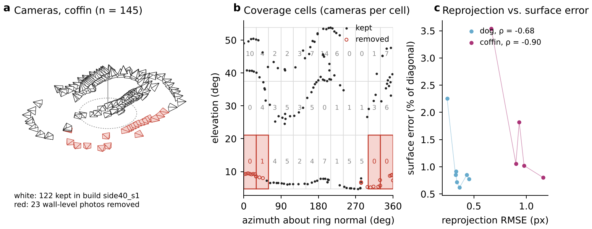

**(a)** The 145 aligned cameras of a museum coffin capture. One build removes 23 wall-level
photos (red). **(b)** The same cameras in azimuth and elevation about the camera ring. Red cells
have fewer than 2 cameras where the full capture has at least 2. **(c)** The usual quick check
after alignment, reprojection RMSE, runs *opposite* to measured surface error within each object
(Spearman ρ −0.68 for 7 dog builds, −0.90 for 5 coffin builds).

Dense multi-view reconstruction is the slow stage of photogrammetry: 57 minutes for the
145-photo coffin on a 16 GB laptop, even at reduced depth-map resolution. This project asks whether the *aligned camera layout*,
available minutes into a capture, predicts the geometric quality of the final mesh. It covers
four parts:

- a reproducible Metashape pipeline;
- a reference-relative surface-error label;
- set models over cameras: PointNet, self-attention, and attention with a learned pairwise-geometry bias;
- a viewer and capture app that show which viewing directions a capture is missing.

## Summary of results

| | result | evidence |
|---|---|---|
| ✔ | Reprojection RMSE does not indicate geometric quality; within each object it is inversely ranked. | 28 real builds, ρ −0.68 / −0.90 |
| ✔ | On **synthetic** camera sets, models that compare cameras before pooling find a coverage gap hidden in one ring; PointNet and summary statistics do not. | attention 14.0° vs. Ridge 27.7°, PointNet 28.8° MAE (5 seeds) |
| ✔ | On synthetic data, a pairwise-geometry bias on the attention logits learns faster, is more stable across seeds, and transfers best to larger camera sets. The shuffled-geometry control does not reproduce the gain. | 17.5 ± 0.5° vs. 21.7 ± 3.4° at 150 epochs; 8.5° vs. 10.6° under a count shift (3 seeds) |
| ✘ | The geometry bias is **not** shown to be more accurate at convergence. At 400 epochs a Xavier-initialised standard attention reaches 13.1° against 15.8°. | 1 seed; initialisation confound |
| ✘ | On **real** builds, no set model is distinguishable from another, and geometry-aware attention does no better than its shuffled control. | 28 builds, 2 objects |
| ~ | The networks' lower cross-object MAE comes from predicting the right error *level*. Ridge ranks builds *within* an unseen object better (ρ +0.59 dog, +0.70 coffin). | 2-fold leave-one-object-out |

The bottleneck is labelled real data (28 builds of 2 objects), not model capacity. Section 7
lists what these results do not support, including three retracted earlier claims.

## Contents

1. [Problem and research question](#1-problem-and-research-question)
2. [Data, pipeline and labels](#2-data-pipeline-and-labels)
3. [Methods](#3-methods)
4. [Synthetic experiments](#4-synthetic-experiments)
5. [Real reconstructions](#5-real-reconstructions)
6. [Tools: viewer and capture app](#6-tools-viewer-and-capture-app)
7. [What the evidence does not support](#7-what-the-evidence-does-not-support)
8. [Limitations](#8-limitations)
9. [Reproducing](#9-reproducing)

## 1. Problem and research question

Structure-from-motion gives camera poses within minutes. Multi-view stereo then builds the dense
surface, and that takes most of the compute. If the camera layout is missing a side of the
object, the surface there will be missing too, but the standard alignment diagnostic does not
show it. Reprojection RMSE measures how consistent the *retained* observations are, not whether
the object was seen from every side. In the coffin builds, the worst mesh had the lowest
reprojection RMSE (0.67 px) and the best mesh had the highest (1.16 px)
(`results/pahma-5-613-v2/labels-all.csv`).

**Question.** Given only the aligned cameras of a build (centres and optical axes), can a model
predict the build's surface error relative to a full capture, and does it help to encode the
pairwise geometry between cameras explicitly?

This is set regression on SE(3) camera poses. The camera order is meaningless, the global
frame is arbitrary (no markers), and the relevant quantity is relational: a gap is a large
angular separation between neighbouring cameras.

## 2. Data, pipeline and labels

| object | capture group | builds | photos per build | reference |
|---|---|---|---|---|
| ARF dog | historical CPU pipeline | 16 | 25–40 | `_reference` (50 photos) |
| ARF dog | GPU pipeline, depth downscale 8 | 7 | 10–38 | `ref50` (50 photos) |
| PAHMA 5-613 coffin | GPU pipeline, depth downscale 8 | 5 scored (+1 failed alignment) | 29–122 | `ref145b` (145 photos) |

Each build is defined by a manifest that lists every photo by SHA-256 together with the
reconstruction settings, and Metashape runs under a memory watchdog
([docs/PIPELINE.md](docs/PIPELINE.md)). Builds remove photos by design: random subsets, a
contiguous side, elevation bands, or thinning. Photos, Metashape projects and meshes are not
distributed. Camera tables and labels are tracked in git.

**Label.** The symmetric surface RMSE between the build's mesh and the reference mesh, as a
fraction of the reference bounding-box diagonal ([docs/METHOD.md](docs/METHOD.md)). Builds
without markers come out in arbitrary frames, so evaluator v3 first fits a similarity transform
of the build's cameras onto the reference cameras over shared photos, then refines with ICP.

<table><tr>
<td width="50%"></td>
<td width="50%">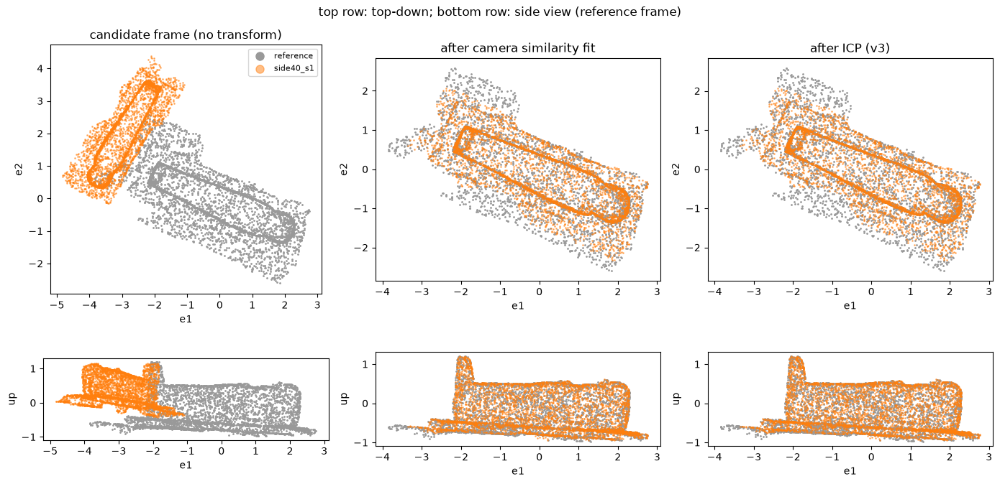</td>
</tr><tr>
<td><sub>Build <code>side40_s1</code>: 122 of 145 photos; a 23-camera wall-level sector removed.</sub></td>
<td><sub>Registration: the build's own frame → camera similarity fit → ICP.</sub></td>
</tr></table>


<sub>For this build, missing-surface RMSE is 1.12% of the diagonal and extra-surface RMSE is 0.15%. The label is 0.80%, and 98% of the squared error is missing surface on the side with no cameras. Every value is recomputed step by step in [`notebooks/01_pipeline_walkthrough.ipynb`](notebooks/01_pipeline_walkthrough.ipynb) and matches the stored row.</sub>

**Evaluation audit.** The first evaluator (v1) started ICP with no rotation. 7 of 16 dog builds
were in frames rotated 136–167° from the reference, and v1 gave them labels of 0.042–0.044
from misregistration alone. With camera-initialised registration the same builds score
0.0033–0.0055. Three earlier results that used v1 labels are retracted
([docs/FINDINGS.md §1](docs/FINDINGS.md#1-evaluation-audit)).

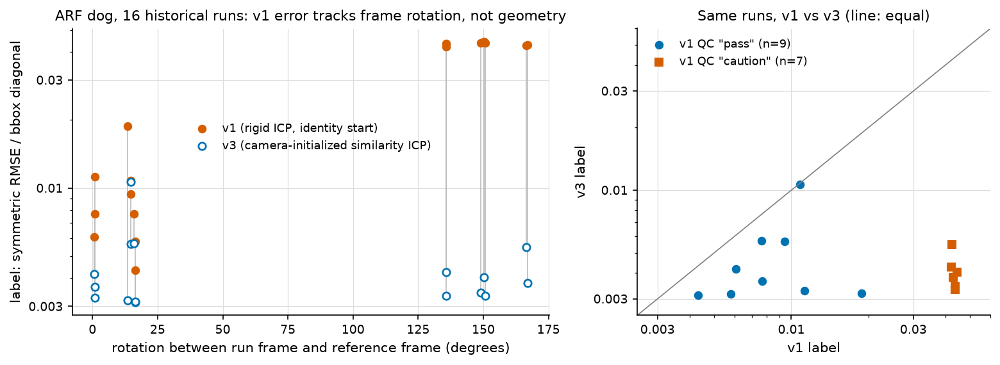

## 3. Methods

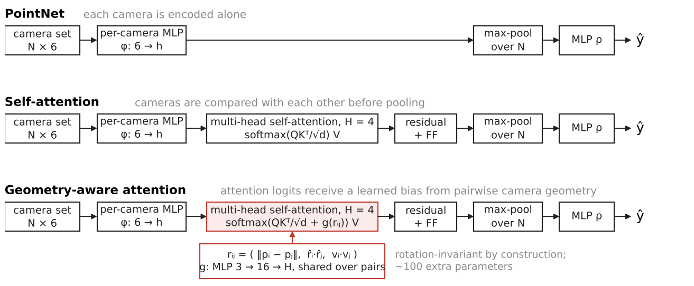

**Input.** Each aligned camera contributes its centre and optical axis, giving
X ∈ ℝ^{N×6}. Camera roll is dropped, since it does not affect coverage. Translation and scale
are removed per build. Rotation is not, because there is no canonical frame without a
reference. The networks instead see a fresh random SO(3) rotation of every set at each step,
and real-data predictions average 8 test rotations.

**Models.** All three share φ (a per-camera MLP), an elementwise max over cameras, and ρ (an
MLP), so they are invariant to camera order. They differ in what happens before the pooling.

- **PointNet** encodes each camera independently. A pooled vector can record that "some camera
  is high", but no camera ever sees another, so it cannot directly represent the gap *between*
  neighbours.
- **Self-attention** adds one multi-head attention block (4 heads, residual, feed-forward)
  before pooling, so each camera is updated by a weighted average of the others.
- **Geometry-aware attention** (`geo`) adds a learned bias to the attention logits:
  `logits_ij = q_i·k_j/√d + g(r_ij)`. The relations are r_ij = (‖p_i − p_j‖, r̂_i·r̂_j, v_i·v_j):
  distance, angular separation seen from the object, and agreement of the optical axes. g is a
  2-layer MLP shared over pairs with one output per head (about 100 parameters). The relations
  are rotation-invariant, which a unit test checks. This is relative position bias in the sense
  of Swin and Graphormer, applied to camera geometry.

**Controls and baselines.**

- `geo_shuf`: the same model with the relations permuted within each set. It has the same
  parameters and compute, but the geometry is destroyed.
- `geo_inv`: only rotation-invariant per-camera inputs.
- `xgb_pair`: the same pairwise angles given to XGBoost as histograms.
- Tabular baselines on summaries: the training mean, a linear fit on reprojection RMSE, Ridge,
  MLP and XGBoost.

Layer-by-layer shapes and the loss are in
[experiments/geometry-aware/ARCHITECTURE.md](experiments/geometry-aware/ARCHITECTURE.md).
`test_geo_models.py` checks that the attention layer without the bias matches
`torch.nn.MultiheadAttention` given the same weights.

<table><tr>
<td width="55%">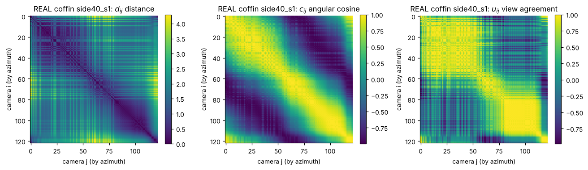</td>
<td width="45%">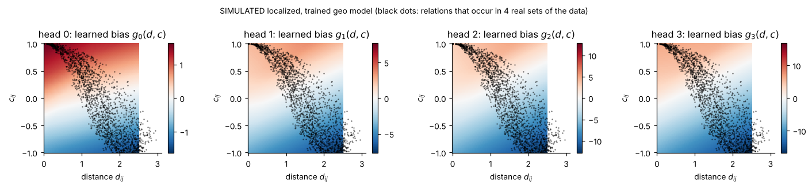</td>
</tr><tr>
<td><sub>The relation matrices of real build <code>side40_s1</code> (cameras ordered by azimuth).</sub></td>
<td><sub>The learned bias per head (synthetic, seed 0) as a function of distance and angular cosine. Dots: relations that occur in real builds.</sub></td>
</tr></table>

## 4. Synthetic experiments

> **Synthetic only.** The target here is the largest *azimuthal coverage gap* (degrees) of a
> generated camera set. It is a geometric proxy for coverage, **not** reconstruction error.

Sets of up to 60 cameras are placed in rings and put in a random similarity frame. In the
**localized** condition one ring is complete and the gap is cut from another, so the model has
to work out which cameras are missing. In the **count-shift** condition models train on
20–35 cameras and are tested on 45–60. Train, validation and test sets are independent draws,
and reported numbers use the last epoch.

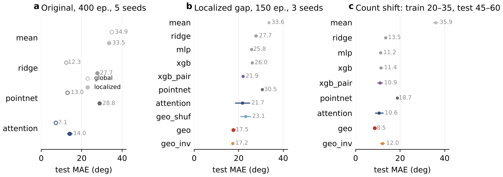

<sub>Test MAE, mean ± s.d. over seeds. **(a)** The original benchmark (`results/synthetic-coverage-gap/summary.csv`): 400 epochs, 5 seeds; open markers show the global gap, filled markers the localized gap. **(b, c)** The geometry-aware study (`experiments/geometry-aware/results/`): 150 epochs with cosine decay, 3 seeds.</sub>

| localized, 150 epochs | mean | Ridge | XGBoost | xgb_pair | PointNet | attention | geo_shuf | **geo** | geo_inv |
|---|---|---|---|---|---|---|---|---|---|
| MAE (°) | 33.6 ± 0.5 | 27.7 ± 0.8 | 26.0 ± 0.5 | 21.9 ± 0.6 | 30.5 ± 0.3 | 21.7 ± 3.4 | 23.1 ± 2.3 | **17.5 ± 0.5** | 17.2 ± 0.6 |

| count shift (train 20–35, test 45–60) | Ridge | XGBoost | xgb_pair | PointNet | attention | **geo** | geo_inv |
|---|---|---|---|---|---|---|---|
| MAE (°) | 13.5 ± 0.5 | 11.4 ± 0.8 | 10.9 ± 1.3 | 18.7 ± 0.1 | 10.6 ± 1.9 | **8.5 ± 0.3** | 12.0 ± 1.1 |

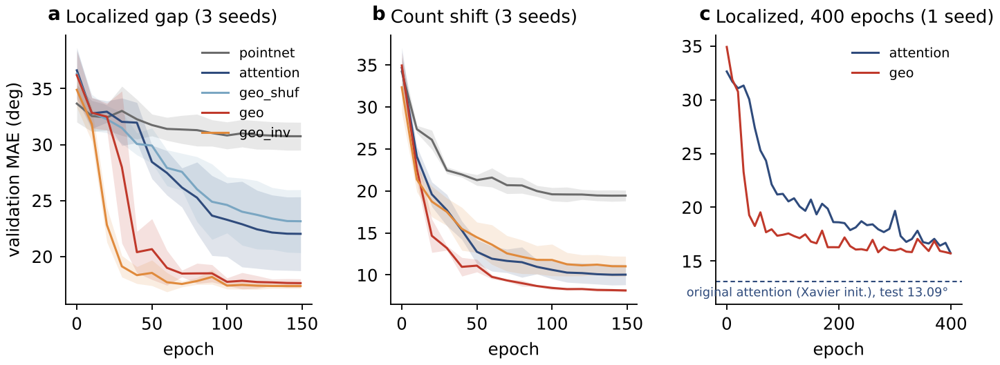

<sub>Validation MAE, mean ± s.d. over 3 seeds. **(a)** geo reaches about 18° by epoch 50; standard attention needs about 200 epochs. **(c)** At 400 epochs (one seed), geo and this attention implementation end at 15.8° and 16.1°. The original attention model, which differs only in initialisation (Xavier-uniform), reaches 13.09° on the same test set.</sub>

**Reading.**

1. **The ablation points to geometry.** `geo_shuf` has the same parameters and compute as
   `geo` but is no better than plain attention, so the gain comes from the relations
   themselves.
2. **The gain is in sample efficiency and stability, not final accuracy.** The seed spread
   is ± 0.5° against ± 3.4°. The convergence comparison above is confounded by initialisation,
   and the clean test (Xavier-initialised `geo`, 400 epochs, 5 seeds) has not been run.
3. **Under a count shift, `geo` transfers best.** The fully invariant `geo_inv` does worse
   (12.0°), because its only per-camera input, distance from the centroid, shifts with the
   camera count.

**Attention maps.**

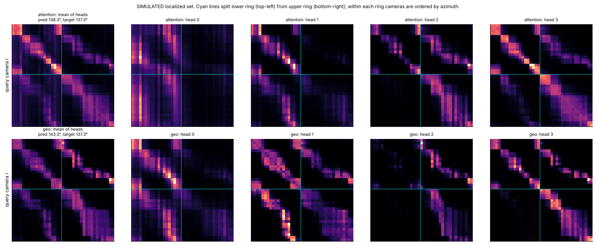

<sub>One localized test set; rows are queries and columns keys, ordered by ring and then azimuth. Top: standard attention; bottom: geo. Saved outputs of [`geometry_aware_attention_analysis.ipynb`](experiments/geometry-aware/geometry_aware_attention_analysis.ipynb) §8.</sub>

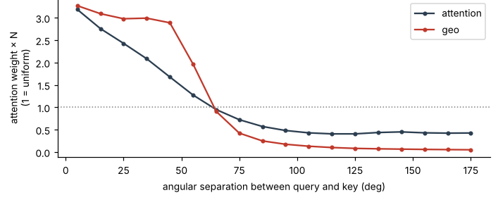

<sub>Mean attention weight (× N; 1 = uniform) against the angular separation between query and key, over 300 test sets. geo concentrates attention on cameras within about 50° and almost ignores the rest; standard attention decays smoothly.</sub>

## 5. Real reconstructions

28 labelled builds. Builds of one capture share photos, so leave-one-build-out leaks
near-duplicates into training. The main splits therefore hold out a whole **capture group**
(LOGO, 3 folds) or a whole **object** (LOAO, 2 folds). Networks use the pilot settings: 400
epochs, full batch, 5 seeds. Tabular models use one fixed setting, with no tuning on 28 points.

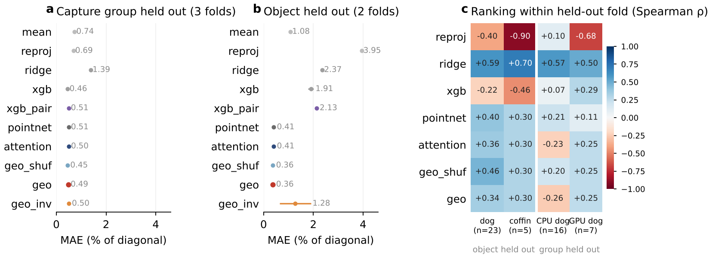

<sub>**(a, b)** MAE in % of the reference diagonal, mean ± s.d. over 5 seeds (`experiments/geometry-aware/results/real/summary.csv`). **(c)** Spearman ρ between seed-mean prediction and label *inside* each held-out fold (`.../real/predictions.csv`). The coffin column has n = 5 and is not statistically meaningful.</sub>

| MAE, % of diagonal | mean | reproj. | Ridge | XGBoost | PointNet | attention | geo_shuf | geo |
|---|---|---|---|---|---|---|---|---|
| LOGO (3 folds) | 0.74 | 0.69 | 1.39 | 0.46 ± 0.01 | 0.51 ± 0.01 | 0.50 ± 0.02 | 0.45 ± 0.04 | 0.49 ± 0.02 |
| LOAO (2 folds) | 1.08 | 3.95 | 2.37 | 1.91 ± 0.11 | 0.41 ± 0.06 | 0.41 ± 0.05 | 0.36 ± 0.07 | 0.36 ± 0.07 |

**Reading.**

1. **No set model separates from another.** PointNet, attention, `geo` and `geo_shuf` overlap
   within one standard deviation under both splits. Under LOGO the shuffled control has the
   lowest MAE, and XGBoost on summaries ties the networks.
2. **Low cross-object MAE comes from predicting the right level, not the right ranking.** Ridge
   and the reprojection fit predict the wrong overall level on a new object, because their
   inputs (camera count, spread, pixel error) shift between the dog and the coffin. Inside each
   held-out object, Ridge ranks builds best (ρ +0.59 on 23 dog builds) and the networks rank
   them weakly (+0.30 to +0.46). On the 16 CPU-pipeline dog builds, attention and `geo` rank
   them *negatively*. Ranking within an object is what matters for choosing between captures.
3. **Reproduction.** Rerunning the original attention model with the new code gives an LOAO MAE
   of 0.41 ± 0.05% against 0.35 ± 0.05% in the pilot (`results/pilot-real-v3-all/summary.csv`).
   The settings are the same; only the rotation streams differ.

Predicted-against-measured scatter plots for every model and split are in the viewer's
*Predicted vs measured* tab, generated from the same saved out-of-fold predictions.

## 6. Tools: viewer and capture app


<sub>An earlier version of the viewer, rendering a locally loaded coffin mesh with the surface each build is missing in red.</sub>

**Viewer** ([live](https://tantan.live/reconstruction-viewer/index.html),
[viewer/README.md](viewer/README.md)). A static browser tool with no build step. It provides:

- a 3D camera network with frustums, picking and look-through-camera;
- the azimuth × elevation coverage analysis, ported from `coverage.py` and tested against it on
  every tracked build;
- comparison of a build against its reference via an Umeyama similarity fit;
- a sortable camera table;
- predicted-vs-measured plots from the saved predictions;
- SVG/CSV export of every figure.

The hosted copy contains camera poses and labels only. Meshes and photos are loaded from a local
folder in the browser and are never uploaded.

**Capture app** (`coverage_app.py`). It takes a photo folder through alignment, a coverage
check against an earlier build of the same object, an optional mesh and a v3 score, using the
same watched commands as the pipeline.

## 7. What the evidence does not support

- **That any model predicts real reconstruction quality.** There are 28 builds and 2 objects,
  and leave-one-object-out is two folds.
- **That geometry-aware attention is more accurate than standard attention at convergence**
  (synthetic), or better on real builds at all.
- **"Attention reduced error by 42–49% vs. Ridge."** This is the synthetic coverage-gap
  benchmark (12.26 → 7.14°, 27.70 → 13.99°), not reconstruction error.
- **"~6× lower error on an unseen object."** This is the 2-fold LOAO pilot against Ridge
  (2.37% vs. 0.35%). Against the mean baseline the ratio is about 3×, against PointNet 1.17×.
  Under leave-one-build-out Ridge is better, and Ridge ranks builds within each object better.
- **Earlier v1-label results** (5.7× error ratio, 13.7% improvement over the reprojection
  baseline). These are retracted; see [docs/FINDINGS.md](docs/FINDINGS.md#earlier-claims-that-no-longer-hold).

## 8. Limitations

- **Scale.** 2 objects and 28 labelled builds. Builds from one capture share photos and are
  correlated.
- **Labels.** They are relative to a reference build of the same object, not to a ground-truth
  scan. All new builds use reduced depth-map resolution (downscale 8) to fit a 16 GB laptop.
- **Design.** Photo subsets are removed by design, so the label range reflects the experiments,
  not natural captures.
- **Inputs.** The models see camera centres and axes only: no image content, no tie points, no
  intrinsics.
- **Synthetic study.** 3 seeds at 150 epochs. The 400-epoch comparison is one seed and
  confounded by initialisation.
- **Output.** One error per build. The models do not localise *where* the geometry is wrong.

**Next.** The first priority is more objects and builds, so that leave-one-object-out has more
than two folds. After that:

- report within-object ranking next to MAE;
- rerun `geo` with matched initialisation;
- predict per-region missing surface;
- extend the same relations to learned image features (e.g. DINOv2) and to feed-forward
  reconstruction (DUSt3R, VGGT) as the pipeline being scored.

## 9. Reproducing

Python 3.11+. `requirements-lock.txt` pins the versions behind the results.

```bash
python3 -m venv .venv && source .venv/bin/activate
python -m pip install -e '.[test,ml,local]' -c requirements-lock.txt
python -m pytest -q                                  # Metashape is mocked
node --test tests/viewer/*.test.mjs                  # viewer coverage port vs. coverage.py
```

| step | command | needs |
|---|---|---|
| figures in this README | `python scripts/make_readme_figures.py` | tracked CSVs only |
| earlier figures, results notebook | `python scripts/make_figures.py`, `python scripts/build_results_notebook.py` | tracked CSVs |
| synthetic benchmark (400 ep., 5 seeds) | `python scripts/synthetic_coverage_gap.py` | CPU |
| real-data pilot | `python scripts/pilot_set_models.py` | tracked camera tables and labels |
| geometry-aware study | `bash experiments/geometry-aware/run_all.sh` | about 80 min on 2 CPU threads |
| viewer data | `python scripts/export_viewer_public.py` | tracked files |
| new builds and labels | `scripts/run_watched.py`, `scripts/score_runs_v3.py` | Metashape Pro, photos ([docs/METASHAPE.md](docs/METASHAPE.md)) |

Every number in this README cites the tracked file it comes from. The scripts are listed in run
order in [scripts/README.md](scripts/README.md).

```
coverage_app.py      capture app
src/bd3d_quality/    manifests, Metashape runner, watchdog, evaluator v3, coverage, viewer export
scripts/             reproduce steps, in run order
experiments/         build manifests; geometry-aware/ holds the attention study (code, results, notebook)
results/             labels, summaries, per-build camera tables
notebooks/           01 pipeline walkthrough, 02 results, 03 attention maps
viewer/              browser viewer (static), public camera data in viewer/public/
docs/                METHOD, PIPELINE, FINDINGS, METASHAPE, attribution, figures
tests/               unit and regression tests; tests/viewer/ for the viewer
archive/             earlier-phase code and documents
```

## Attribution

Parts of the mesh loading, sampling and ICP code, and the manifest and metrics concepts, are
adapted from the Aphoma repository (`bd3d-ml` branch), released under CC0 1.0
([docs/ATTRIBUTION.md](docs/ATTRIBUTION.md)). The objects belong to their collections; photos,
Metashape projects and meshes are not distributed.
