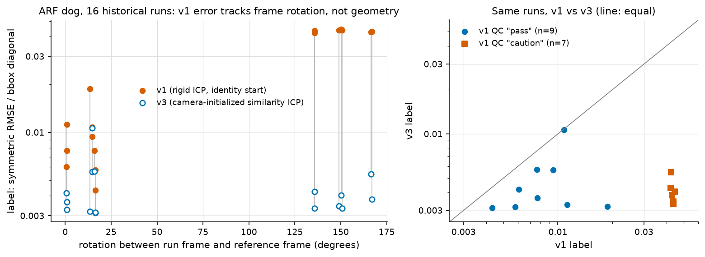
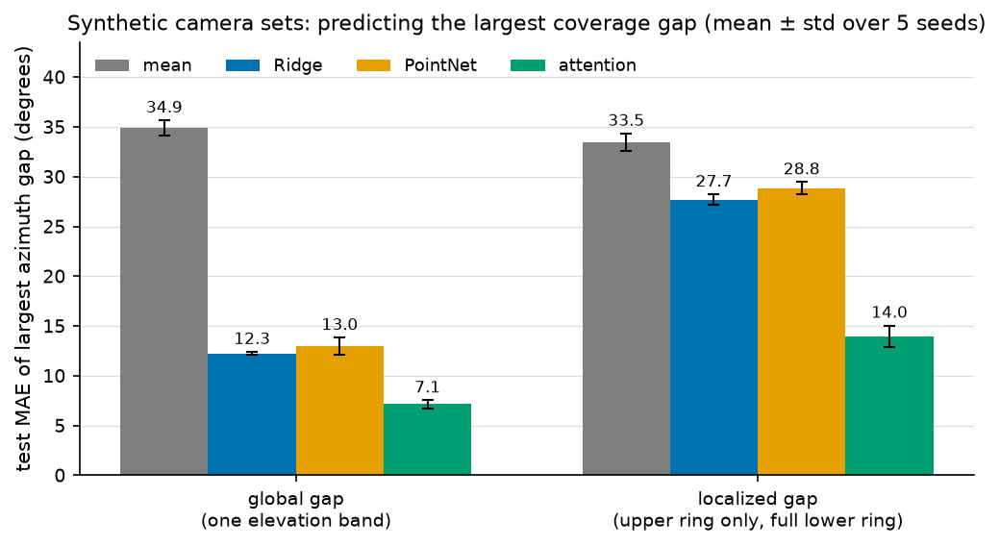
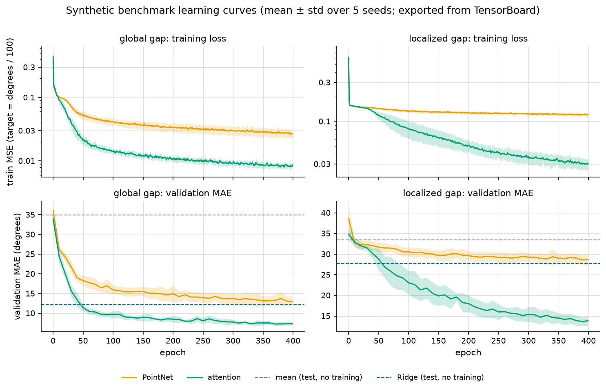
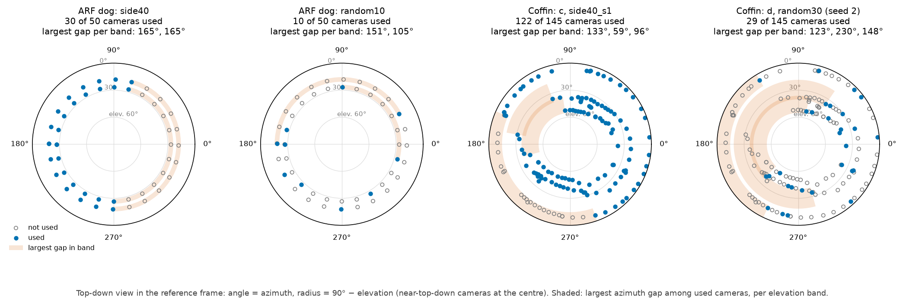
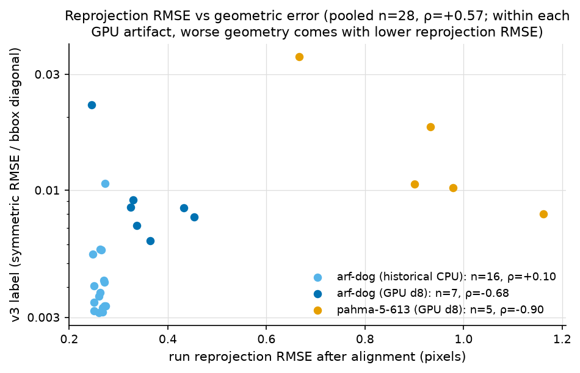
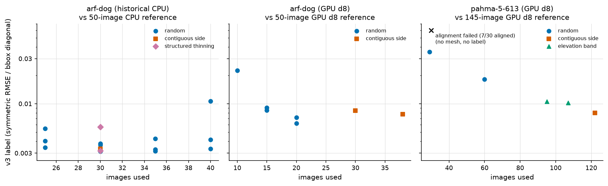
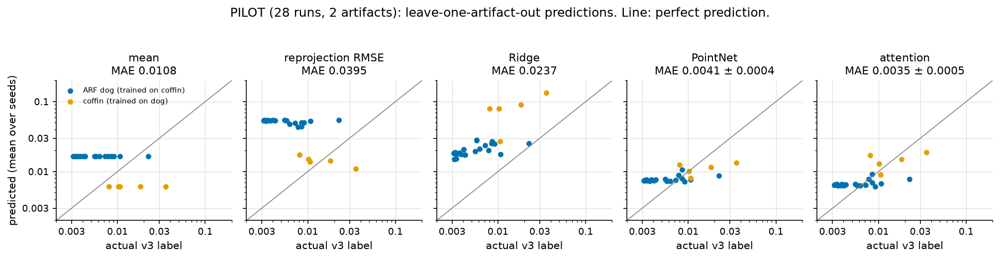
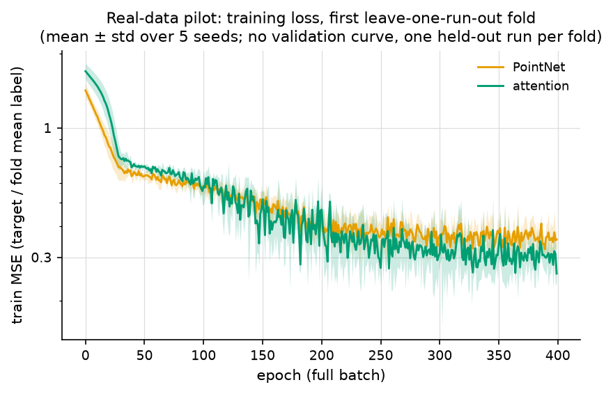

# Findings

The long version of the four findings summarised in the [README](../README.md). Every number
cites the tracked file it comes from. Method details (labels, reference, evaluator v3) are in
[METHOD.md](METHOD.md).

## 1. Evaluation audit

The first evaluator (v1) registered each candidate mesh to the reference with rigid ICP,
starting from a centroid shift and no rotation. Metashape reconstructions without markers are
in arbitrary local frames, and v1 did not account for that.

Among the 16 historical ARF dog builds, 7 were in frames rotated 135.7–166.9° from the
reference; the other 9 were within 0.6–16.5°. ICP cannot recover a rotation that large from an
identity start. All 7 large-rotation builds were flagged "caution" by v1 and received labels of
0.0421–0.0444, a plateau set by misregistration. All 9 small-rotation builds passed.

Evaluator v3 starts from a similarity fit (rotation, translation, uniform scale) of each
build's cameras onto the reference cameras over shared photos, then refines it with ICP that
allows uniform scale. After rescoring, all 16 builds pass QC with camera and ICP scale in
agreement. Labels span 0.0031–0.0107, and the 7 formerly failed builds fall at 0.0033–0.0055.

Sources: `docs/figures/data/stats.json` (`evaluation_audit`) and
`docs/figures/data/evaluation_audit.csv`, both derived from
`results/geometry-labels-v3/reports/*.json`; labels in `results/geometry-labels-v3/labels_v3.csv`.
The step-by-step diagnosis is in `results/geometry-labels-v3/NOTES.md`.

### Earlier claims that no longer hold

Three of my earlier results, on the Aphoma `bd3d-ml` branch, used v1 labels and do not hold
with v3; I retract them. Each was recomputed from the same modelling table, first with the v1
labels to confirm the method, then with the v3 labels.

| claim (bd3d-ml, v1 labels) | reproduced with v1 | with v3 labels |
|---|---|---|
| central gap vs remove-strongest-overlap, 30 photos: 5.7× higher error | 5.68× | 0.58× (central gap is lower) |
| Spearman ρ, reprojection RMSE vs geometric error: −0.17 | −0.174 | +0.103 |
| early-SfM Ridge, leave-one-condition-out RMSE improvement over the reprojection baseline: 13.7% | 13.7% | −5.6% (worse) |
| same model, improvement over the image-count baseline: 11.2% | 11.2% | −0.5% |
| same model, improvement over the dummy baseline: 10.7% | 10.7% | −12.0% |

Source: `results/bd3d-ml-claims-recheck/claims.csv`, made by `scripts/recheck_bd3d_ml_claims.py`.

## 2. Synthetic benchmark

Synthetic camera sets of up to 60 cameras are placed in a random similarity frame and then
normalised by centroid and median camera distance. The target is the largest azimuthal
coverage gap, in degrees. In the global condition the gap is cut from one elevation band. In
the localized condition a full lower ring is kept and the gap is cut from an upper ring, so a
model has to find which cameras are missing. Each seed uses 3000 training, 600 validation and
600 test sets and 400 epochs, over 5 seeds (`results/synthetic-coverage-gap/config.json`).

Ridge uses rotation-invariant summaries (count, covariance eigenvalues, radial mean and
standard deviation). PointNet applies a per-camera MLP and max-pooling. The attention model
adds one self-attention layer before the pooling, so cameras can be compared with each other.
The networks see a fresh random rotation of each set at every step.

| model | global gap, MAE (°) | localized gap, MAE (°) | localized skill |
|---|---|---|---|
| mean | 34.89 ± 0.77 | 33.47 ± 0.86 | 0 |
| Ridge | 12.26 ± 0.15 | 27.70 ± 0.51 | 0.17 |
| PointNet | 12.99 ± 0.84 | 28.82 ± 0.63 | 0.14 |
| attention | 7.14 ± 0.39 | 13.99 ± 1.06 | 0.58 |

Mean ± standard deviation over 5 seeds; skill = 1 − MAE / MAE of the mean. Source:
`results/synthetic-coverage-gap/summary.csv`.

All three models beat the mean on the global gap. On the localized gap, Ridge and PointNet
barely improve on the mean, and attention keeps most of its skill.

The benchmark predicts an angular gap, not surface error. It shows that these models can read
camera layout. It does not show that layout determines reconstruction quality.

## 3. Real-data observations

Two objects were reconstructed at reduced depth-map resolution (Metashape downscale 8) on the
GPU. The ARF dog has 50 photos in two 25-photo rings. The PAHMA 5-613 coffin has 145 photos in
three capture series: a circuit facing the walls, a circuit at about 45°, and near top-down.
Every candidate build is scored against the full-capture build of its own object.

### Reprojection RMSE against the label

| builds | n | Spearman ρ |
|---|---|---|
| ARF dog, historical CPU builds | 16 | +0.10 |
| ARF dog, GPU builds | 7 | −0.68 |
| PAHMA 5-613 coffin, GPU builds | 5 | −0.90 |
| all pooled | 28 | +0.57 |

Source: `docs/figures/data/stats.json` (`reprojection_vs_label`). Within each GPU object,
removing photos lowered the reprojection RMSE while the geometry got worse. The pooled positive
value reflects the difference between the two objects.

### ARF dog, against the 50-photo reference

| build | photos | v3 label | missing RMSE | extra RMSE | dominant (share of squared error) | reproj. RMSE (px) |
|---|---|---|---|---|---|---|
| random10 | 10 | 0.0225 | 0.0304 | 0.0094 | missing (91%) | 0.25 |
| random15, seed 20261111 | 15 | 0.0091 | 0.0119 | 0.0050 | missing (85%) | 0.33 |
| random15, seed 20261110 | 15 | 0.0085 | 0.0105 | 0.0059 | missing (76%) | 0.32 |
| side40 (20 removed, one sector) | 30 | 0.0085 | 0.0101 | 0.0065 | missing (71%) | 0.43 |
| side25 (12 removed, one sector) | 38 | 0.0078 | 0.0073 | 0.0083 | extra (56%) | 0.45 |
| random20, seed 20261110 | 20 | 0.0072 | 0.0091 | 0.0044 | missing (82%) | 0.34 |
| random20, seed 20261111 | 20 | 0.0062 | 0.0073 | 0.0050 | missing (68%) | 0.36 |

Source: `results/gpu-pilot-d8-ext/labels.csv`.

### PAHMA 5-613 coffin, against the 145-photo reference

| build | photos | v3 label | missing RMSE | extra RMSE | dominant (share of squared error) | reproj. RMSE (px) |
|---|---|---|---|---|---|---|
| random30, seed 20261111 | 29 aligned | 0.0354 | 0.0499 | 0.0039 | missing (99%) | 0.67 |
| random60 | 60 | 0.0182 | 0.0257 | 0.0022 | missing (99%) | 0.93 |
| drop_s3 (highest elevation cluster) | 95 | 0.0106 | 0.0139 | 0.0055 | missing (86%) | 0.90 |
| drop_s2 (middle elevation cluster) | 107 | 0.0102 | 0.0080 | 0.0120 | extra (69%) | 0.98 |
| side40_s1 (23 wall-level cameras, one sector) | 122 | 0.0080 | 0.0112 | 0.0015 | missing (98%) | 1.16 |
| random30, seed 20261110 | 30 | — | — | — | alignment failed (7 of 30 cameras aligned) | 0.33 |

Source: `results/pahma-5-613-v2/labels-all.csv`; the failed build is from
`docs/figures/data/real_runs.csv`. All scored builds pass registration QC, and camera and ICP
scale agree.

In every random subset, missing surface is the larger error component (68–99% of the squared
error), reaching 99% for the coffin at 60 and 30 photos.

No random subset removed the same number of photos as a side removal, so the two are not
compared at equal counts. For the dog, removing 20 photos as one sector (side40, 30 kept) scored
0.0085, the same as random15 seed 20261110, which removed 35. For the coffin, removing 23
wall-level photos as one sector (side40_s1) gave the lowest label, 0.0080; the builds with the
nearest removal counts are the elevation bands drop_s2 (38 removed, 0.0102) and drop_s3 (50
removed, 0.0106).

Extra surface dominates in two builds, coffin drop_s2 and dog side25. Their meshes contain
geometry the reference does not, which is consistent with noisier surfaces where coverage is
thinner.

One 30-photo random coffin subset aligned only 7 cameras, so no mesh exists for it. A useful
model needs to predict that outcome as well as the label.

The coffin's 45° and near-top-down series overlap in elevation (21–43° and 31–53° in the
reference frame), so the pose-based clusters mix them. drop_s3 removed the 50 highest cameras:
31 near-top-down and 19 from the 45° circuit. The wall-level circuit matches its capture series
exactly. Source: `results/overnight-2026-11-10-summary.md`.

## 4. Pilot: models on 28 real builds

This is a feasibility check on very small, correlated data.

The data are 28 builds: 16 historical CPU builds and 7 GPU builds of the ARF dog, and 5 GPU
builds of the coffin (`results/pilot-real-v3-all/runs.csv`). Inputs are the aligned cameras:
positions centred on their centroid and divided by the median camera distance, plus viewing
directions, with random-rotation augmentation during training. The models are the training
mean, a linear fit on reprojection RMSE, Ridge on global summaries, and PointNet and attention
set models (hidden size 32). Evaluation is leave one build out (LORO) and leave one object out
(LOAO), with 5 seeds for the networks; the other three models are deterministic.

| model | LORO MAE | LORO skill | LOAO MAE | LOAO skill |
|---|---|---|---|---|
| mean | 0.00461 | 0 | 0.01082 | 0 |
| reprojection RMSE | 0.00422 | +0.08 | 0.03945 | −2.65 |
| Ridge | 0.00303 | +0.34 | 0.02365 | −1.19 |
| PointNet | 0.00365 ± 0.00003 | +0.21 ± 0.01 | 0.00409 ± 0.00044 | +0.62 ± 0.04 |
| attention | 0.00343 ± 0.00013 | +0.26 ± 0.03 | 0.00351 ± 0.00053 | +0.68 ± 0.05 |

Source: `results/pilot-real-v3-all/summary.csv`. Skill = 1 − MAE / MAE of the mean.

Leaving one build out, Ridge does best, but subsets of the same capture share photos, so this
scheme is optimistic. Leaving one object out, Ridge and the reprojection fit fail because their
inputs shift between objects: coffin builds have reprojection RMSE around 0.67–1.16 px and dog
builds 0.25–0.45 px (`results/pahma-5-613-v2/labels-all.csv`, `results/gpu-pilot-d8-ext/labels.csv`).
The set models stay in a plausible range but underpredict the worst coffin build. The mean
baseline predicts the other object's mean, which inflates the positive LOAO skill values. With
two folds and 28 correlated builds, none of these differences is reliable.

## Next steps

- A third object, so that leave-one-object-out has more than two folds.
- Rerun the two coffin band removals on the true capture series. The capture-time split now
  ignores a pause after the first or last photo.
- Repeat a subset of builds at full depth-map resolution to measure how much downscale 8
  changes the labels.
- Predict alignment failure as a separate outcome.
