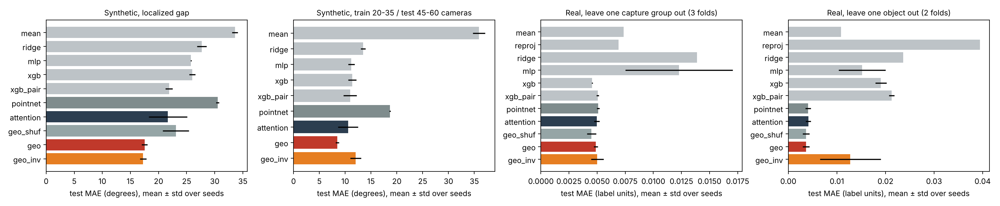
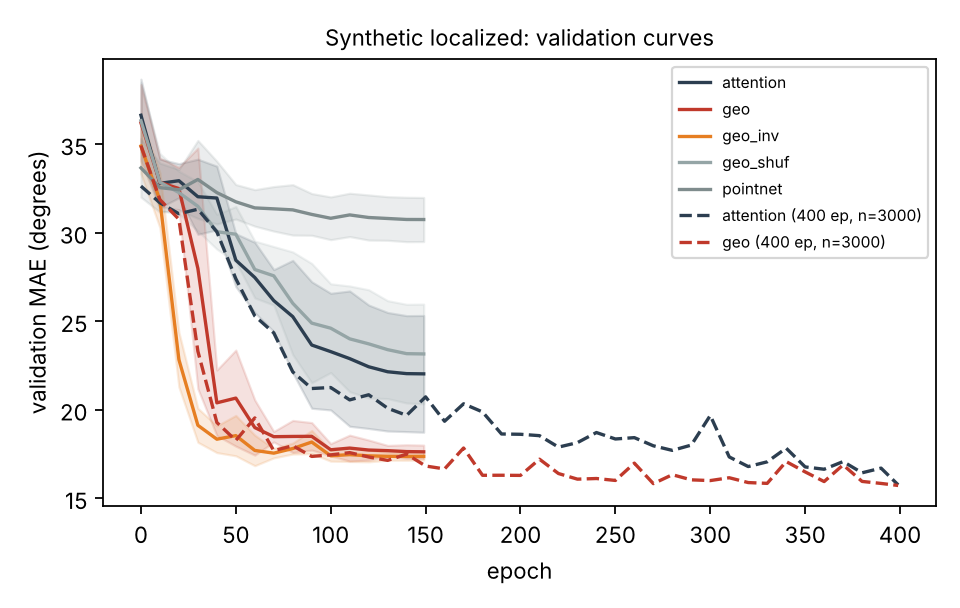

# Geometry-aware attention for camera-set quality prediction

Does giving a set model the pairwise geometry between cameras (distance, angular separation,
view agreement) as a bias on its attention logits help it predict reconstruction quality or
coverage, and generalize? Architecture: [ARCHITECTURE.md](ARCHITECTURE.md). Code:
`geo_models.py`, `run_experiments.py`; everything reruns with `run_all.sh` (about 80 min on 2 CPU
threads) and `make_figures.py`. Tests: `test_geo_models.py`. Walkthrough with figures:
`geometry_aware_attention_analysis.ipynb` (its geo model comes from `train_cached_models.py`).

## Audit of the existing results

- The real dataset is 28 labelled builds of 2 objects: 23 dog (16 historical CPU builds, 7 GPU
  builds) and 5 coffin. Leave-one-object-out has 2 folds.
- "Attention cut MAE 42–49% vs. Ridge" is the synthetic coverage-gap benchmark
  (12.26 → 7.14° and 27.70 → 13.99°), not reconstruction error.
- "~6× lower error on an unseen object" is the real leave-one-object-out pilot: Ridge 0.0237,
  attention 0.0035. Ridge fails across objects because its inputs (camera count, spread) shift
  between the dog and the coffin. Against the mean baseline (0.0108) it is ~3×, against PointNet
  (0.0041) 1.17×, and under leave-one-run-out Ridge (0.0030) beats attention (0.0034).

## Setup

Models: mean; reprojection-RMSE fit (real only); Ridge, MLP and XGBoost on the existing
rotation-invariant summaries; **xgb_pair**, XGBoost on the summaries plus a histogram of pairwise
angular separations and nearest-neighbour angle statistics; PointNet; the existing attention
model; **geo** (attention + geometric bias); **geo_inv** (geo with only rotation-invariant
per-camera inputs); **geo_shuf** (geo with the relations shuffled within each set: same
parameters and compute, geometry destroyed).

| experiment | data | training |
|---|---|---|
| synthetic localized | the existing generator, 2000 train / 600 val / 600 test, 3 seeds | 150 epochs, Adam 3e-3, cosine decay, batch 128 |
| synthetic count shift | one band; train and val 20–35 cameras, test 45–60 | as above, 3 seeds |
| synthetic long check | localized, 3000 train, 1 seed | 400 epochs, Adam 1e-3 (the original setting) |
| real | the 28 builds of `results/pilot-real-v3-all` | as the pilot: 400 epochs, Adam 1e-3, wd 1e-4, full batch, 8 test rotations, 5 seeds |

Real splits: leave one capture group out (LOGO: dog-CPU / dog-GPU / coffin, 3 folds), because
builds of one capture share photos and leave-one-run-out leaks; and leave one object out (LOAO).
Tabular models on real data use one fixed setting (no tuning on 28 points); on synthetic data
they are tuned on the validation set. All networks are scored at their last epoch.

## Results

**Synthetic, localized gap** (MAE in degrees, mean ± std over 3 seeds)

| mean | ridge | mlp | xgb | xgb_pair | pointnet | attention | geo_shuf | **geo** | **geo_inv** |
|---|---|---|---|---|---|---|---|---|---|
| 33.6 ± 0.5 | 27.7 ± 0.8 | 25.8 ± 0.1 | 26.0 ± 0.5 | 21.9 ± 0.6 | 30.5 ± 0.3 | 21.7 ± 3.4 | 23.1 ± 2.3 | **17.5 ± 0.5** | **17.2 ± 0.6** |

**Synthetic, camera-count shift** (train 20–35 cameras, test 45–60)

| mean | ridge | mlp | xgb | xgb_pair | pointnet | attention | **geo** | geo_inv |
|---|---|---|---|---|---|---|---|---|
| 35.9 ± 1.2 | 13.5 ± 0.5 | 11.2 ± 0.6 | 11.4 ± 0.8 | 10.9 ± 1.3 | 18.7 ± 0.1 | 10.6 ± 1.9 | **8.5 ± 0.3** | 12.0 ± 1.1 |

**Long check** (localized, 3000 sets, 400 epochs, seed 0): attention 16.06°, geo 15.81°. The original
attention model trained with the same data and settings (`runs/attention-maps/attention_localized_seed0.pt`)
scores 13.09° on the same test set; see finding 2.

**Real builds** (MAE in label units, mean ± std over 5 seeds; deterministic models have one value)

| split | mean | reproj | ridge | xgb | pointnet | attention | geo_shuf | geo | geo_inv |
|---|---|---|---|---|---|---|---|---|---|
| LOGO (3 folds) | 0.0074 | 0.0069 | 0.0139 | 0.0046 ± 0.0001 | 0.0051 ± 0.0001 | 0.0050 ± 0.0002 | 0.0045 ± 0.0004 | 0.0049 ± 0.0002 | 0.0050 ± 0.0006 |
| LOAO (2 folds) | 0.0108 | 0.0395 | 0.0237 | 0.0191 ± 0.0011 | 0.0041 ± 0.0006 | 0.0041 ± 0.0005 | 0.0036 ± 0.0007 | 0.0036 ± 0.0007 | 0.0128 ± 0.0063 |

Rank correlation (Spearman ρ) between prediction and label *inside* each held-out object, LOAO,
predictions averaged over seeds:

| held out | reproj | ridge | xgb | pointnet | attention | geo | geo_shuf |
|---|---|---|---|---|---|---|---|
| dog (n = 23) | −0.40 | **+0.59** | −0.22 | +0.40 | +0.36 | +0.34 | +0.46 |
| coffin (n = 5) | −0.90 | **+0.70** | −0.46 | +0.30 | +0.30 | +0.30 | +0.30 |

MLP: 0.0123 ± 0.0048 (LOGO), 0.0152 ± 0.0049 (LOAO).

## Findings

1. **On the synthetic localized task, pairwise geometry helps, and the control says it is the
   geometry.** geo and geo_inv reach 17.5° and 17.2° against 21.7° for attention at the same
   budget, with a seventh of the seed-to-seed spread (± 0.5 vs ± 3.4). geo_shuf, which has the
   same parameters and compute but mismatched relations, is no better than attention (23.1°).
   Giving XGBoost the same pairwise angles helps it (26.0 → 21.9°) but not as much as putting
   them inside attention.
2. **It learns faster, not better.** geo reaches ~18° validation MAE by epoch 50; attention
   needs ~200 epochs (curves above). At 400 epochs my attention implementation and geo end at
   16.06° and 15.81° (one seed), but the original attention implementation reaches 13.09° on the
   same seed and 13.99 ± 1.06° over 5 seeds (README). The two attention implementations compute the
   same function and differ only in initialisation (`nn.MultiheadAttention`: Xavier-uniform input
   projections, zero biases; `geo_models.GeoAttention`: default `nn.Linear`). So the original
   attention is likely more accurate than geo at convergence, and the honest claim is sample and
   compute efficiency and stability. Closing this needs geo with Xavier initialisation, 400 epochs,
   5 seeds.
3. **It generalizes best to larger camera sets.** Trained on 20–35 cameras and tested on 45–60,
   geo has the lowest error (8.5° vs 10.6° for attention and 10.9° for the best tree model).
   The fully invariant geo_inv does worse here (12.0°): its only per-camera input is distance
   from the centroid, which shifts with camera count.
4. **On the 28 real builds, nothing separates the set models.** PointNet, attention, geo and
   geo_shuf overlap within one standard deviation under both splits, and geo is no better than
   its shuffled control, so the data cannot show an effect of geometry. XGBoost on summaries
   ties the best networks under LOGO.
5. **The cross-object advantage of the networks is about level, not ranking.** Under LOAO the
   networks have the lowest MAE, but inside each held-out object Ridge ranks builds best
   (ρ = +0.59 on 23 dog builds, +0.70 on 5 coffin builds) and the networks rank them weakly
   (+0.30 to +0.46). Ridge's large MAE comes from predicting the wrong overall level on the new
   object. MAE across objects mixes the two; ranking inside an object is the more useful number
   for choosing between captures.
6. **Reproduction.** My rerun of the existing attention model gives LOAO 0.0041 ± 0.0005 vs
   0.0035 ± 0.0005 in `results/pilot-real-v3-all` (same settings, different rotation streams),
   and 16.1° vs 14.0 ± 1.1° on the synthetic localized task at 400 epochs (1 seed vs 5).

## Limitations

- Real data: 28 builds, 2 objects, correlated builds within a capture, labels relative to a
  reference build. No real-data comparison between set models is meaningful at this size.
- Synthetic: the target is an azimuthal gap, a geometric proxy for coverage, not surface error.
  3 seeds; the long check is 1 seed. The 150-epoch budget is shorter than the original 400.
- The rank correlations rest on 23 and 5 builds; with 5 coffin builds the coffin values are not
  statistically meaningful.

## What would move this forward

1. More real builds across more objects, so leave-one-object-out has more than 2 folds and
   within-object ranking can be tested with confidence. This is the bottleneck, not the model.
2. Report within-object rank correlation next to MAE for every real-data result.
2b. Rerun geo with `nn.MultiheadAttention`-style initialisation at 400 epochs, 5 seeds.
3. A geo model with a richer per-camera input that survives the count shift (e.g. distance
   divided by the set's median, plus local density), and relations from full poses (relative
   rotation, baseline-to-depth ratio) once the label set is large enough to tell.
4. Then the extensions: use the same relations with learned image features (e.g. frozen
   DINOv2 embeddings per photo) or with feed-forward reconstruction (DUSt3R, VGGT) as the
   pipeline being scored; predict where geometry is missing rather than one number per build;
   choose the next camera that most reduces predicted error (next-best view).

## Resume bullets these results support

- Designed geometry-aware attention for camera-set models (learned pairwise-geometry bias on
  attention logits); on a synthetic coverage benchmark it generalized best to unseen camera
  counts (8.5° vs 10.6° MAE for standard attention, 3 seeds, matched 150-epoch budget), with a
  shuffled-geometry control
  showing the gain comes from the geometry
- Benchmarked 11 models with leakage-safe splits on 28 real reconstructions; found that
  cross-object MAE gains reflected predicted error level rather than ranking, with Ridge ranking
  builds best within each unseen object (Spearman ρ = 0.59)

Not supported: that geo is more accurate at convergence (at 400 epochs the original attention
reaches 13.1° vs geo's 15.8° on the same seed), or that any set model beats another on the real
builds.
